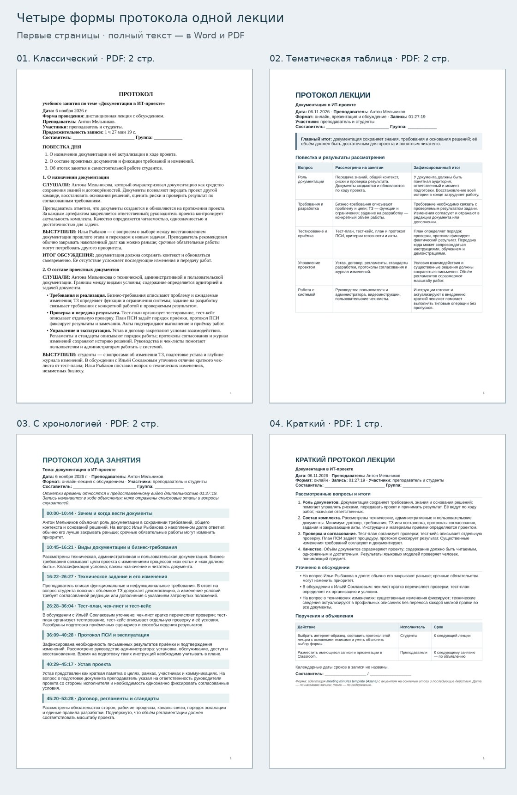

# Четыре формы протокола лекции

Варианты по одной записи: лекция Антона Мельникова о документации в ИТ-проекте от **6 ноября 2026 года**, продолжительность **01:27:19**. Меняются структура, степень подробности и оформление.

| № | Вариант | Что в нём главное | Объём PDF | Файлы |
|---|---|---|---|---|
| 01 | **Классический** | Повестка и последовательность «Слушали — Выступили — Итог обсуждения»; поручения выделены отдельно. Строгое оформление. | 2 страницы | [Word](01-classic.docx) · [PDF](01-classic.pdf) · [Текст](01-classic.md) |
| 02 | **Тематическая таблица** | По каждой теме сразу видны содержание и вывод. На второй странице — вопросы студентов и дальнейшие действия. | 2 страницы | [Word](02-thematic.docx) · [PDF](02-thematic.pdf) · [Текст](02-thematic.md) |
| 03 | **С хронологией** | Двенадцать смысловых этапов с отметками времени, вопросами слушателей и итогами. Удобно сверять с записью. | 2 страницы | [Word](03-chronological.docx) · [PDF](03-chronological.pdf) · [Текст](03-chronological.md) |
| 04 | **Краткий** | Главные тезисы, три уточнения из обсуждения и поручения с исполнителями и сроками. | 1 страница | [Word](04-brief.docx) · [PDF](04-brief.pdf) · [Текст](04-brief.md) |

Для сдачи прежде всего стоит посмотреть **вариант 02**: он ясно связывает рассмотренный вопрос с итогом и сохраняет обсуждение. **Вариант 01** подойдёт для привычного делового оформления; **03** — если хочется показать ход занятия; **04** — для максимально компактного результата.

ФИО и группа составителя во всех документах оставлены пустыми. Объём указан для PDF; в Word разбиение страниц зависит от установленных шрифтов и редактора.

## Интернет-образцы и адаптация

### 01. Классический протокол

**Образец:** [Л. В. Санкина. «Подготовка совещаний и оформление протокола», «Дело-пресс»](https://delo-press.ru/journals/documents/oformlenie-dokumentov/34972-podgotovka-soveshchaniy-i-oformlenie-protokola/).

Использована организация текста по повестке с изложением доклада и выступлений. Учебная адаптация сохраняет реальные разъяснения и поручения преподавателя; постановления вымышленного коллегиального органа не добавлялись. Итоги обсуждения обозначены отдельно.

**Как объяснить выбор:** «Я выбрал классическую форму, потому что в лекции был доклад и вопросы слушателей. Она позволяет показать, что изложил преподаватель, что уточнили студенты и какое задание получили».

### 02. Тематическая таблица

**Образец:** [Meeting Minutes Template, University of Utah](https://regulations.utah.edu/general/guidelines/g1-002.pdf).

В образце для каждого вопроса предусмотрены обсуждение, результат и дальнейшие действия. В адаптации содержание сгруппировано в таблицу «вопрос — рассмотрено — итог»; задания вынесены в завершающий блок. Результаты учебного обсуждения обозначены как выводы, а не как голосование.

**Как объяснить выбор:** «Я выбрал эту форму, потому что она связывает каждую тему с её основным выводом. Для лекции о документации это наглядно показывает, зачем нужен документ и что важно зафиксировать».

### 03. Протокол с хронологией

**Образец:** [Meeting Minutes Format, Loyola University New Orleans](https://academicaffairs.loyno.edu/about/committees/meeting-minutes-format).

Использован принцип последовательной записи тем с кратким изложением и точками обсуждения. Отметки времени — дополнение составителя для работы с видеозаписью, а не требование университетского образца. Разделы объединяют смысловые этапы; поминутная стенограмма не требуется.

**Как объяснить выбор:** «Я выбрал последовательную форму, чтобы сохранить логику занятия и место каждого вопроса. Таймкоды помогают быстро найти объяснение и проверить формулировку по видео».

### 04. Краткий протокол

**Образец:** [Meeting minutes template, Asana](https://asana.com/templates/meeting-minutes).

Использован акцент на ключевых итогах и последующих действиях. Документ сокращён до одной страницы: основные положения, уточнения и таблица поручений. Указаны только озвученные сроки — к следующей лекции или занятию; календарные даты не назначались составителем.

**Как объяснить выбор:** «Я выбрал краткую форму, потому что преподаватель просил зафиксировать тезисы, а не полностью пересказать лекцию. В одном документе видны содержание, уточнения и полученное задание».

## Основание содержания

[Исходная видеозапись](https://drive.google.com/file/d/10N8NaXE_t5mzaZlpLyjsHZVDzz2XNykS/view) и её слайды. Для проверки использована уже подготовленная расшифровка; интернет-материалы определяют форму документов. Дата взята из названия файла, тема сформулирована по содержанию. Официальное название дисциплины не подставлялось.

[Первая версия протокола и подробные опорные таймкоды](../format-and-sources.md) · [Все материалы репозитория](../../../README.md)
